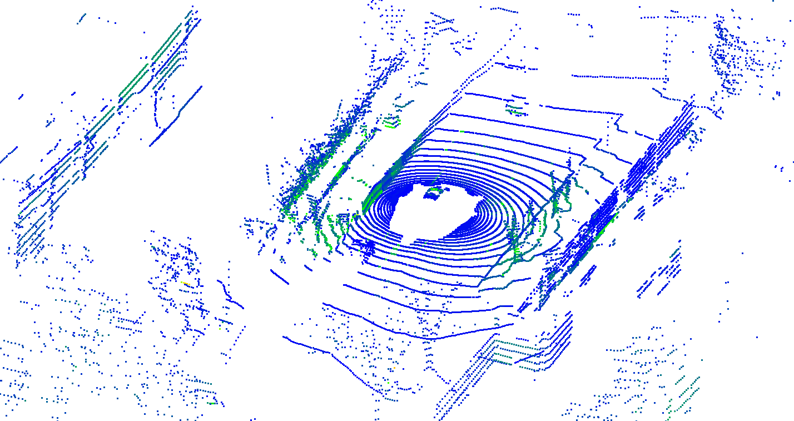
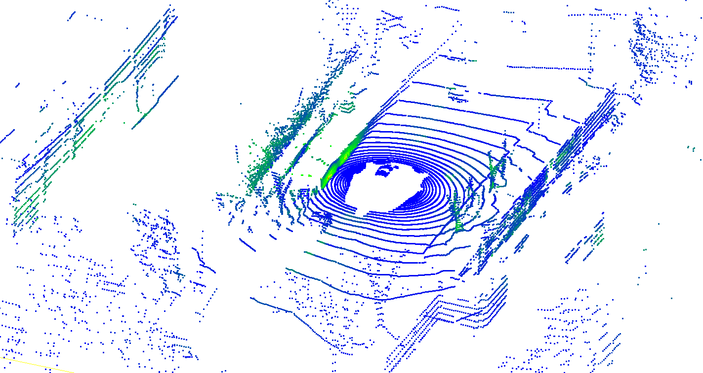

<h1 align="center">NIDAR</h1>

<p align="center"><strong>NIR-Guided Intrinsic Decomposition for Scalable Scene-Agnostic<br>LiDAR Intensity Reconstruction</strong></p>
<p align="center">Official implementation &middot; IROS 2026</p>

<p align="center">
  <a href="https://arxiv.org/abs/2609.36878"></a>
  <a href="https://huggingface.co/zhangjunjie587/NIDAR"></a>
  <a href="LICENSE"></a>
</p>

<p align="center">
  <a href="https://nidar-web.github.io/">Project page</a> &middot;
  <a href="#quick-start">Quick start</a> &middot;
  <a href="docs/DEMO.md">Demo guide</a> &middot;
  <a href="docs/DATA_ACCESS.md">Data access</a> &middot;
  <a href="docs/MODEL_ZOO.md">Models</a>
</p>

**Add a synthesized intensity channel to an existing point cloud.** NIDAR
combines RGB appearance, a pseudo-NIR prior, intrinsic decomposition, and
distribution calibration. Inputs include RGB images, XYZ geometry, and
camera/LiDAR calibration; outputs include intensity-valued point clouds and
visual comparisons.

<table>
  <tr><th width="50%">Ground-truth intensity</th><th width="50%">NIDAR intensity</th></tr>
  <tr>
    <td></td>
    <td></td>
  </tr>
</table>

*Existing nuScenes research example from the [project page](https://nidar-web.github.io/#nuscenes-comparisons).
This figure is not a validation run of the new official-data converter.*

## Quick Start

Use Python 3.10 and PyTorch 2.6 or newer. PyTorch 2.8 is used for checkpoint
release checks. Install a PyTorch build appropriate for your CPU/GPU.

```bash
git clone https://github.com/Zjj587/NIDAR.git
cd NIDAR
conda create -n nidar python=3.10 -y
conda activate nidar
pip install -r requirements.txt
python tools/download_weights.py --weights-root ./weights
```

The downloader uses a pinned Hugging Face revision and checks file sizes and
SHA-256. No login is needed. Add `--check-only` to verify existing files.

Choose a dataset, download it from the official provider, and prepare two frames:

| Dataset | Download and conversion guide |
| --- | --- |
| Waymo | [Official two-frame TFRecord or your own segment](docs/DATA_ACCESS.md#waymo) |
| nuScenes | [Official mini split -> two keyframes](docs/DATA_ACCESS.md#nuscenes) |

Then run the complete pipeline in your NIDAR inference environment:

```bash
python inference/run_nidar_demo.py \
  --input-root ./data/waymo_demo \
  --weights-root ./weights \
  --output-root ./outputs/demo \
  --viewer auto
```

The default processes two frames. Use `--frame-count 1` for a one-frame input,
`--device cpu` for CPU inference, or `--viewer none` on a headless machine.
For nuScenes, use `--input-root ./data/nuscenes_demo` and a fresh output directory.
The input manifest selects the dataset and its remap calibration automatically.
Add `--check-input` to validate inputs before inference. No author-hosted sample
is needed; we do not redistribute Waymo or nuScenes data.

For the interactive Open3D window, also run `pip install -r requirements-viewer.txt`.
Static PNG previews do not need Open3D. See the [demo guide](docs/DEMO.md).

## What You Get

Outputs are written under `./outputs/demo/results/`:

| Output | Purpose |
| --- | --- |
| `frame_*/nidar_intensity.npy` | XYZ coordinates and synthesized intensity |
| `frame_*/nidar_intensity.ply` | Point cloud with scalar intensity |
| `frame_*/nidar_intensity_colored.ply` | Point cloud ready for color visualization |
| `frame_*/nidar_intensity_preview.png` | Static point-cloud preview |
| `frame_*/comparison.png` | Ground-truth/prediction range-image comparison |
| `frame_*/comparison_masked.png` | Comparison restricted to jointly valid pixels |
| `summary.json`, `evaluation_summary.json` | Output manifest and evaluation summary |

Evaluation requires ground-truth intensity in the export. `--no-eval` skips
comparison images and metrics while retaining the synthesized point cloud.
See [troubleshooting](docs/TROUBLESHOOTING.md) for setup and output questions.

## Method And Models

```text
RGB -> STN pseudo-NIR -> IRNet R -> LiDAR-camera projection
    -> quantile remapping -> intensity point cloud
```

The default route uses **R + quantile remapping**. IRNet contains a U-Net
intrinsic network and a DeepLab intensity head; the direct intensity output
I_hat is not the final signal in this route.

| Artifact | Runtime path | Availability |
| --- | --- | --- |
| STN | `weights/stn/47.pth` | [Hugging Face](https://huggingface.co/zhangjunjie587/NIDAR) |
| IRNet, U-Net + DeepLab | `weights/irnet/epoch_010.pth` | [Hugging Face](https://huggingface.co/zhangjunjie587/NIDAR) |
| Waymo quantile calibration | `weights/quantile/wintensity_mapping_quantile_model.pkl` | Bundled and copied by the downloader |
| nuScenes quantile calibration | `inference/quantile_model/nintensity_mapping_quantile_model.pkl` | Bundled; selected automatically for nuScenes |

The STN is based on cs-stereo and is frozen for inference. Checkpoint identities,
training metadata and attribution are in the [model zoo](docs/MODEL_ZOO.md).
Small-head IRNet checkpoints are incompatible with this default.

## Supported Workflows

| Workflow | Current scope |
| --- | --- |
| Waymo raw TFRecord -> inference | Official two-frame SDK fixture passed; full-segment acceptance remains separate |
| nuScenes converter | Official mini `scene-0061`, two keyframes with six cameras; raw conversion and SDK projection checks passed |
| Converted nuScenes inference | Full CPU `R + remap` route and saved-image inspection passed on those two frames; no full-split benchmark |
| Static previews and MAE/RMSE/SSIM evaluation | Included |
| Interactive point-cloud viewing | Optional Open3D dependency |
| Training and downstream experiment harnesses | Not included in this inference release |

See [tested environments and acceptance results](docs/RELEASE_ACCEPTANCE.md).
These small CPU checks validate the demo workflow, not full-split quality or
CUDA performance. A research result and a tested public integration are distinct.

## Limits

NIDAR estimates an intensity-like signal; it does not recover sensor-independent
absolute returned power or generate XYZ from RGB. Range, visibility, exposure,
and sensor domain affect the result. Quantile calibrations are dataset-specific,
not sensor-independent. Intrinsic outputs may lose detail or vary between adjacent frames.

## Contributing And Support

Read [troubleshooting](docs/TROUBLESHOOTING.md), or open a
[GitHub issue](https://github.com/Zjj587/NIDAR/issues) with the command,
environment, checkpoint identities, and relevant log excerpt.
[CONTRIBUTING.md](CONTRIBUTING.md) describes focused fixes and checks.

## Citation

```bibtex
@misc{zhang2026nidar,
  author = {Junjie Zhang and Jie Yin and Kefei Qian and Jie Li and
            Mengpei Jia and Yajuan Dun and Wenbo Chu and Guofa Li},
  title = {{NIDAR}: {NIR}-Guided Intrinsic Decomposition for Scalable Scene-Agnostic {LiDAR} Intensity Reconstruction},
  year = {2026},
  eprint = {2609.36878},
  archivePrefix = {arXiv},
  primaryClass = {cs.RO},
  url = {https://arxiv.org/abs/2609.36878}
}
```

## License And Acknowledgments

The source code is released under [Apache 2.0](LICENSE). Weights, calibration,
datasets, and third-party components have separate terms; see the
[artifact notices](https://huggingface.co/zhangjunjie587/NIDAR/blob/main/LICENSE_NOTICES.md).
The STN builds on [cs-stereo](https://github.com/tiancheng-zhi/cs-stereo).
Media provenance is in [docs/assets/README.md](docs/assets/README.md).
